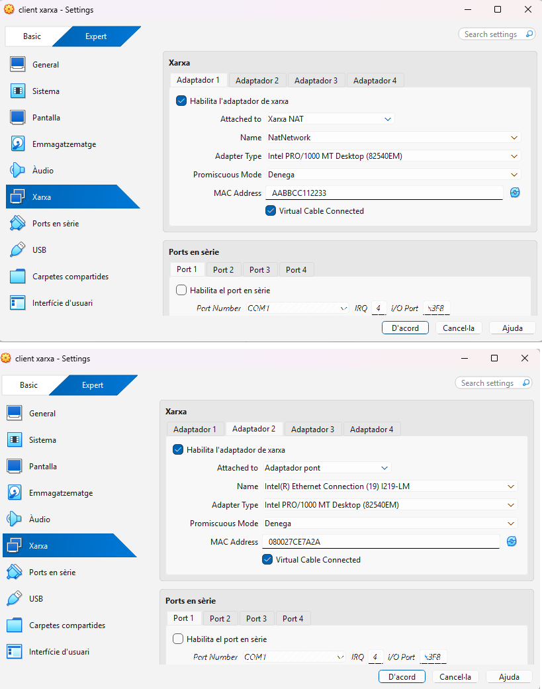
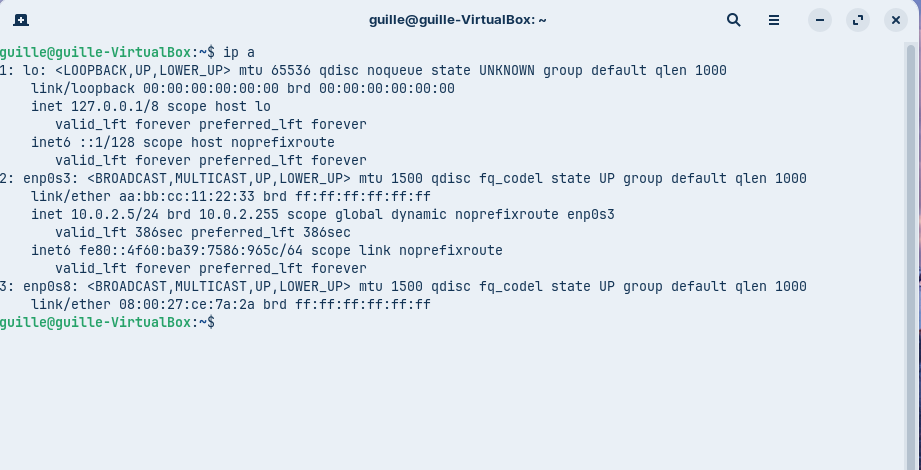
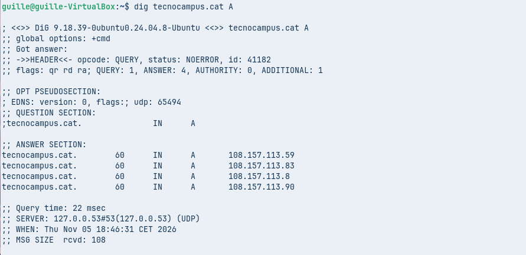
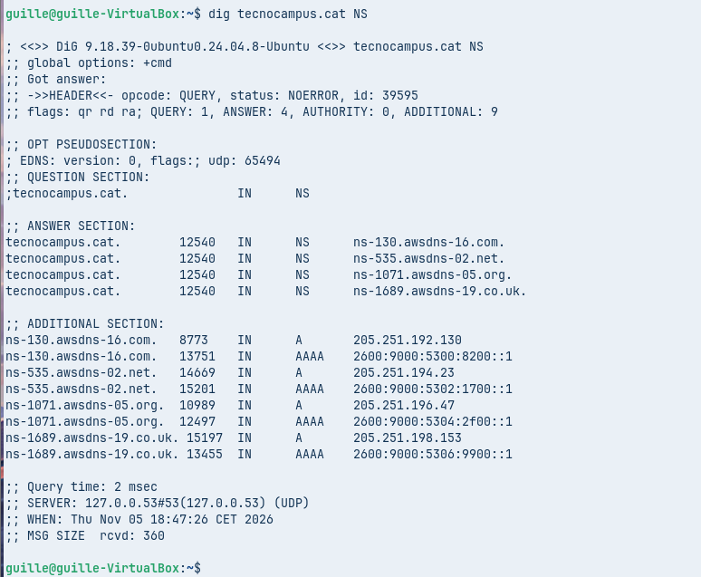
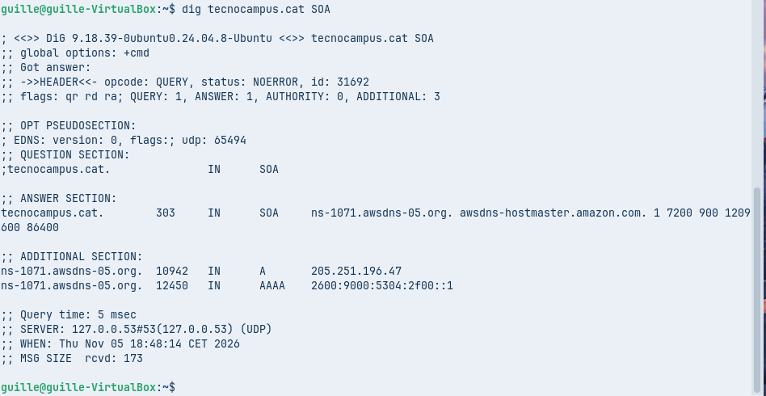
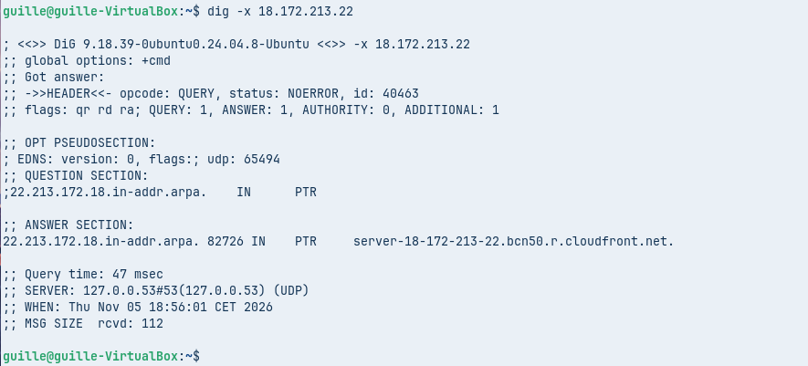
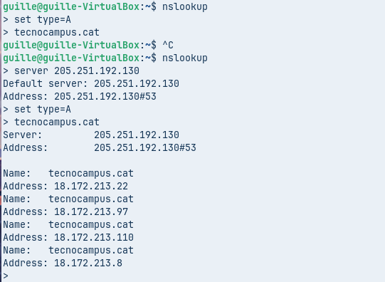
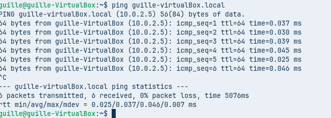

# Projecte de Consultoria DNS – TechCloud Solutions
**Client:** Innovació Tecnològica del Maresme S.L.  
**alumne:** Guille  
**Data:** Novembre 2026  

---

## 1. Fase Teòrica: Píndola Formativa i Recursos Educatius
* **Enllaç al vídeo de la píndola formativa:** [ENGANXA_AQUÍ_EL_TEU_ENLLAÇ_DE_YOUTUBE_O_DRIVE]
* **Descripció del recurs:** Píndola audiovisual d'entre 5 i 10 minuts amb un mapa conceptual adjunt on s'explica de manera teòrica el concepte de DNS, la gestió de dominis, l'arquitectura jeràrquica en arbre, el funcionament de les consultes recursives i iteratives, el paper dels Root Servers i servidors autoritatius, els tipus de zones i la resolució local mitjançant mDNS.

---

## 2. Configuració de l'Entorn de Treball i Xarxa (Zorin OS)

La màquina virtual s'ha configurat amb dues interfícies de xarxa per complir amb els requisits tècnics de l'auditoria:
1. **Interfície 1 (`enp0s3`):** Configurada en mode **NAT** per proporcionar sortida a Internet.
2. **Interfície 2 (`enp0s8`):** Configurada en mode **Adaptador pont (Bridged)** amb IP estàtica assignada per a l'entorn de xarxa local.

### Comprovació de les interfícies de xarxa (`ip a`)
[cite: 6]
* **Anàlisi de xarxa:** S'observa la interfície `enp0s3` amb una IP dinàmica de la xarxa NAT (`10.0.2.5/24`) i la interfície `enp0s8` llista per operar en el pont local[cite: 6].

---

## 3. Fase Pràctica: Auditoria de Resolució de Noms (CLI)

### Part A. Diagnosi avançada amb `dig`

#### 1. Consulta bàsica de registre A (`dig tecnocampus.cat A`)
[cite: 7]
* **Anàlisi tècnica:**
  * **IPs de resposta:** S'obtenen diverses adreces IPv4 associades al domini (`108.157.113.59`, `108.157.113.83`, `108.157.113.8`, `108.157.113.90`)[cite: 7], pròpies d'una CDN de distribució de continguts.
  * **TTL (Time To Live):** El temps de vida establert és de 60 segons, fet que permet una alta dinamització i canvis ràpids de rutes.
  * **Servidor DNS resolutor:** La consulta ha estat gestionada pel resolutor local del sistema (`127.0.0.53#53`)[cite: 7].

#### 2. Consulta de servidors de noms (`dig tecnocampus.cat NS`)
[cite: 8]
* **Anàlisi tècnica:**
  * Els servidors autoritatius (*Name Servers*) del domini pertanyen a Amazon Route 53[cite: 8]:
    * `ns-130.awsdns-16.com` (IP: `205.251.192.130`)[cite: 8]
    * `ns-535.awsdns-02.net` (IP: `205.251.194.23`)[cite: 8]
    * `ns-1071.awsdns-05.org` (IP: `205.251.196.47`)[cite: 8]
    * `ns-1689.awsdns-19.co.uk` (IP: `205.251.198.153`)[cite: 8]

#### 3. Consulta detallada SOA (`dig tecnocampus.cat SOA`)
[cite: 8]
* **Anàlisi tècnica:**
  * **Correu de l'administrador (`rname`):** `awsdns-hostmaster.amazon.com` (on el primer punt substitueix la @)[cite: 8].
  * **Número de sèrie (`serial`):** `1`, utilitzat per al control de versions i actualitzacions de la zona entre servidors primaris i secundaris[cite: 8].

#### 4. Consulta de resolució inversa (`dig -x 18.172.213.22`)
[cite: 9]
* **Anàlisi tècnica:**
  * Mitjançant el domini especial `in-addr.arpa`, la IP s'ha resolt de manera inversa obtenint el registre `PTR`: `server-18-172-213-22.bcn50.r.cloudfront.net`[cite: 9]. Això confirma la pertinença de la IP a la infraestructura de CloudFront (Barcelona).

---

### Part B. Comprovació de resolució amb `nslookup` (Mode interactiu)

#### 1. Consulta autoritativa directa (`server 205.251.192.130`)
[cite: 9]
* **Anàlisi tècnica:**
  * En configurar explícitament el servidor DNS d'Amazon (`205.251.192.130`) dins de l'eina `nslookup` i llançar la consulta del registre `A` per a `tecnocampus.cat`, les adreces retornades (`18.172.213.22`, etc.) provenen directament de la font autoritativa[cite: 9]. En aquest escenari, l'avís de resposta no autoritativa desapareix completament, garantint la validesa oficial de la dada.

---

### Part C. Resolucions locals i protocol mDNS

#### 1. Prova de resolució local amb mDNS (`ping guille-virtualBox.local`)
[cite: 9]

#### 2. Anàlisi tècnica del protocol mDNS
* **Funcionament:** El mDNS (*Multicast DNS*) permet resoldre noms d'amfitrió dins de la xarxa local d'una manera autònoma, sense necessitat d'un servidor DNS dedicat[cite: 9]. Els equips interroguen de forma multicast a la resta de dispositius de la subxarxa[cite: 9].
* **Port i servei:** Opera a través del protocol **UDP al port 5353**[cite: 9].
* **Avantatges:** Ofereix una integració ràpida i transparent (*Zero Configuration* o *Bonjour/Avahi*) en entorns domèstics o oficines de mides reduïdes[cite: 9].

---

## 4. Declaració de Fonts i Eines Consultades
* Documentació tècnica de les comandes de xarxa en entorns Linux (`man dig`, `man nslookup`).
* Manuals de referència sobre registres SOA, NS, PTR i el protocol mDNS.
* Ús de sistemes d'intel·ligència artificial com a suport per a l'estructuració formal i redacció de la guia tècnica.
* ** [https://share.gemini.google/G0q1gPIpN5rh]
